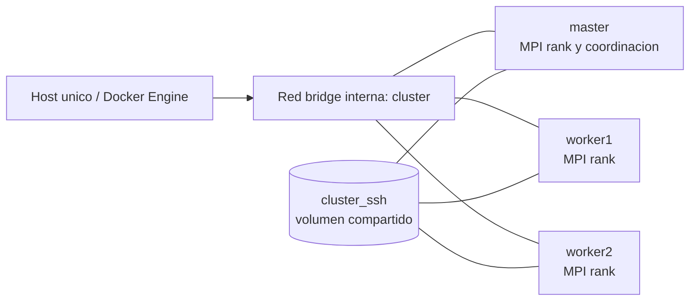

# Esqueleto de informe técnico IEEE

**Proyecto:** Dron Guardián  
**Asignatura:** TEL-420 · Sistemas Paralelos · UAJMS  
**Docente:** Ing. Elias Cassal Baldiviezo  
**Repositorio:** https://github.com/Moico1/dron-guardia  
**Límite:** máximo 10 páginas. Este archivo es una estructura de trabajo; no es el informe final.

## 1. Resumen y Abstract

### Contenido que aporta el repositorio

- Problema, objetivo didáctico y alcance: [docs/hito1-perfil-tecnico.md](hito1-perfil-tecnico.md), [docs/relacion-juego-motor-cluster.md](relacion-juego-motor-cluster.md).
- Método: simulación sintética sobre malla, referencia serial, OpenMP por escenarios y MPI con reducción: [src/include/fire_model.h](../src/include/fire_model.h), [src/sequential/fire_serial.c](../src/sequential/fire_serial.c), [src/parallel/fire_omp.c](../src/parallel/fire_omp.c), [src/parallel/fire_mpi.c](../src/parallel/fire_mpi.c).
- Evidencia de correctitud: [scripts/verify.sh](../scripts/verify.sh), [scripts/verify_modes.sh](../scripts/verify_modes.sh).
- Aceleraciones observadas en la medición actual: ver `data/performance_summary.csv`, hardware `nproc=4`, `MemTotal=12258180 kB`.

### Datos que aún no existen

- Texto final del resumen y Abstract.
- Nombre oficial del equipo, número de grupo y afiliación completa.
- Medición repetida en la Dell OptiPlex 7010 del laboratorio.
- Cifras finales que el equipo decida reportar después de repetir las pruebas oficiales.

## 2. Introducción y contexto regional

### Contenido que aporta el repositorio

- Contexto del Gran Chaco, Sachapera y Yacuiba: [docs/hito1-perfil-tecnico.md](hito1-perfil-tecnico.md#problema-regional).
- Propósito educativo, alcance sintético y advertencias: [README.md](../README.md), [docs/relacion-juego-motor-cluster.md](relacion-juego-motor-cluster.md).
- Tres modos web y su relación con cargas C: [data/recon.conf](../data/recon.conf), [data/wind.conf](../data/wind.conf), [data/interface.conf](../data/interface.conf).

### Datos que aún no existen

- Estadísticas regionales verificadas y referencias bibliográficas específicas del contexto local.
- Fuentes institucionales que el equipo decida citar.
- Validación con datos observados o cartografía real; el modelo actual es sintético.

## 3. Marco teórico

### Taxonomía de Flynn

El motor serial corresponde a una ejecución secuencial. OpenMP representa paralelismo de memoria compartida sobre un proceso con varios hilos. MPI representa paralelismo de memoria distribuida mediante procesos y comunicación colectiva. La clasificación exacta que se use en el texto final debe ser revisada por el equipo.

### Memoria compartida frente a distribuida

- OpenMP: los hilos comparten el espacio de memoria del proceso; el bucle de simulaciones usa `reduction(+:hits)` en [src/parallel/fire_omp.c](../src/parallel/fire_omp.c).
- MPI: cada proceso mantiene su estado local, recibe una parte cíclica de los escenarios y combina impactos con `MPI_Reduce` en [src/parallel/fire_mpi.c](../src/parallel/fire_mpi.c).
- La configuración del clúster usa contenedores separados, pero en esta estación todos comparten el mismo host físico y su red bridge Docker.

### Red de interconexión

La ejecución distribuida del clúster usa la red bridge interna de Docker, no una red física entre tres computadoras. La latencia y el ancho de banda de esta red no fueron medidos.

### Datos que aporta el repositorio

- Modelo probabilístico y malla: [src/include/fire_model.h](../src/include/fire_model.h).
- Particionamiento OpenMP/MPI: archivos de implementación anteriores.
- Smoke tests: [src/parallel/mpi_smoke.c](../src/parallel/mpi_smoke.c), [scripts/smoke_omp.sh](../scripts/smoke_omp.sh).

### Datos que aún no existen

- Medición de latencia/ancho de banda de la red bridge.
- Prueba de escalabilidad débil formal.
- Confirmación docente de la taxonomía y el modelo de memoria que se desea enfatizar.

## 4. Diseño de arquitectura e infraestructura

### Diagrama del clúster

### Implementación real del Compose

| Servicio | Hostname | CPU asignada en Compose | RAM asignada en Compose | Red | Volumen |
|---|---|---|---|---|---|
| `master` | `master` | No definida; comparte CPUs del host | No definida; comparte límite del host | `cluster` bridge | `cluster_ssh:/shared/ssh` |
| `worker1` | `worker1` | No definida; comparte CPUs del host | No definida; comparte límite del host | `cluster` bridge | `cluster_ssh:/shared/ssh` |
| `worker2` | `worker2` | No definida; comparte CPUs del host | No definida; comparte límite del host | `cluster` bridge | `cluster_ssh:/shared/ssh` |

Fuente: [infrastructure/compose.yaml](../infrastructure/compose.yaml). El volumen contiene la clave SSH efímera usada por el entrypoint: [infrastructure/cluster_entrypoint.sh](../infrastructure/cluster_entrypoint.sh).

### Hardware

- Hardware visible durante la medición actual: `nproc=4`, `MemTotal=12258180 kB` (aprox. 11,69 GiB).
- **Dell OptiPlex 7010 del laboratorio: pendiente de medir en el laboratorio.** No se sustituye esa medición con una especificación nominal.
- El MPI del clúster se ejecuta en contenedores sobre un solo host, no sobre una red física entre máquinas.

### Datos que aún no existen

- CPU, RAM disponible, frecuencia, afinidad y límites reales de la Dell OptiPlex durante la práctica.
- Diagrama físico del laboratorio.
- Asignación explícita de CPU/RAM por contenedor, porque Compose no la define.

## 5. Implementación paralela

### Contenido que aporta el repositorio

- Referencia secuencial: [src/sequential/fire_serial.c](../src/sequential/fire_serial.c).
- OpenMP: paralelización del índice de simulación, `schedule(static|dynamic)` y `reduction(+:hits)`: [src/parallel/fire_omp.c](../src/parallel/fire_omp.c).
- MPI: reparto cíclico por rank y `MPI_Reduce`: [src/parallel/fire_mpi.c](../src/parallel/fire_mpi.c).
- Modelo y semilla reproducible: [src/include/fire_model.h](../src/include/fire_model.h).
- Parámetros sintéticos por carga: [data/](../data/).

### Hallazgos de revisión

- El conteo OpenMP usa reducción, no `atomic` ni `critical`.
- La función de simulación crea `state`, `burning` y `next` como variables locales por llamada.
- No se observa RNG global compartido ni falso compartido evidente entre acumuladores de hilos.
- La lógica de propagación no se modificó en Fases 2-3.

### Datos que aún no existen

- Perfilador de CPU que cuantifique cada cuello de botella.
- Afinidad de procesos/hilos fijada y comparada.
- Prueba en varios hosts físicos.

## 6. Resultados y análisis de rendimiento

### Condiciones de medición

La tabla siguiente usa la campaña de **10 repeticiones**, con el clúster detenido. Hardware visible: `nproc=4`, `MemTotal=12258180 kB` (aprox. 11,69 GiB). No es la Dell OptiPlex 7010 del laboratorio. Los CSV son [data/performance_modes.csv](../data/performance_modes.csv) y [data/performance_summary.csv](../data/performance_summary.csv).

Los tres tamaños son cargas de trabajo sobre la misma malla C fija `24 x 16`, no tres escenarios físicos distintos:

| Modo/carga | Simulaciones | Interpretación |
|---|---:|---|
| `recon` | 5.000 | Tamaño pequeño propuesto |
| `wind` | 20.000 | Tamaño medio propuesto |
| `interface` | 50.000 | Tamaño grande propuesto |

### Tiempos medianos, speedup y eficiencia

| Modo | Variante | Trabajadores | Mediana T (s) | Speedup | Eficiencia |
|---|---|---:|---:|---:|---:|
| recon | serial | 1 | 0.137212 | 1.000000 | 1.000000 |
| recon | OpenMP | 2 | 0.079799 | 1.719470 | 0.859735 |
| recon | OpenMP | 4 | 0.081796 | 1.677490 | 0.419373 |
| recon | OpenMP | 8 | 0.061070 | 2.246799 | 0.280850 |
| recon | MPI | 2 | 0.092040 | 1.490787 | 0.745393 |
| recon | MPI | 3 | 0.050653 | 2.708862 | 0.902954 |
| wind | serial | 1 | 0.470571 | 1.000000 | 1.000000 |
| wind | OpenMP | 2 | 0.262474 | 1.792829 | 0.896415 |
| wind | OpenMP | 4 | 0.198392 | 2.371925 | 0.592981 |
| wind | OpenMP | 8 | 0.182238 | 2.582178 | 0.322772 |
| wind | MPI | 2 | 0.313353 | 1.501728 | 0.750864 |
| wind | MPI | 3 | 0.186359 | 2.525078 | 0.841693 |
| interface | serial | 1 | 1.192651 | 1.000000 | 1.000000 |
| interface | OpenMP | 2 | 0.700084 | 1.703583 | 0.851791 |
| interface | OpenMP | 4 | 0.417544 | 2.856348 | 0.714087 |
| interface | OpenMP | 8 | 0.448986 | 2.656321 | 0.332040 |
| interface | MPI | 2 | 0.752331 | 1.585274 | 0.792637 |
| interface | MPI | 3 | 0.429665 | 2.775769 | 0.925256 |

OpenMP con 8 hilos se ejecutó sobre un host que expuso 4 CPUs; por ello hay sobresuscripción. En `wind`, el MPI de 3 procesos fue más rápido que OpenMP de 4 hilos en esta campaña, pero esto no prueba superioridad general: son runtimes distintos y MPI también usa procesos locales sobre la misma máquina.

### Variación y anomalía de `wind`

La medición previa de 5 repeticiones quedó en el commit de Fase 3. Para `wind` OpenMP con 2 hilos registró mediana `0.244823 s`, speedup `1.870429` y eficiencia `0.935214`; el resumen versionado anterior no conservó sus extremos. La campaña aislada final de 10 repeticiones registró mediana `0.262474 s`, speedup `1.792829` y eficiencia `0.896415`; sus tiempos fueron `mín=0.237316 s`, `máx=0.394724 s`, desviación estándar `0.044741 s` según `data/performance_modes.csv`. La medición final no respalda la eficiencia superlineal 1.064 observada en una ejecución anterior; la variación es compatible con ruido del sistema y costos fijos de una carga corta.

### Karp-Flatt y Amdahl

Para una aceleración medida $S_p$, se usa la fracción serial aparente:

$$e_p=\frac{1/S_p-1/p}{1-1/p}.$$

Valores calculados con las medianas de 10 repeticiones para `wind`:

| Variante | p | Speedup | $e_p$ Karp-Flatt | Límite $1/e_p$ de Amdahl |
|---|---:|---:|---:|---:|
| OpenMP | 2 | 1.792829 | 0.115555 | 8.653861 |
| OpenMP | 4 | 2.371925 | 0.228798 | 4.370668 |
| OpenMP | 8 | 2.582178 | 0.299737 | 3.336257 |
| MPI | 2 | 1.501728 | 0.331799 | 3.013872 |
| MPI | 3 | 2.525078 | 0.094041 | 10.633654 |

Estos límites son extrapolaciones del modelo de Amdahl a partir de una fracción aparente; no son una medición de escalabilidad infinita. Cuando $e_p<0$, el speedup observado supera $p$ y el cálculo de una fracción serial física no es interpretable; se reporta como efecto de medición, no como paralelismo ideal. El aumento de $e_p$ en OpenMP con 8 hilos es compatible con sobresuscripción del host de 4 CPUs y costos de ejecución, pero no identifica por sí solo una causa única.

### Gustafson y tamaños de carga

Los tamaños `5.000`, `20.000` y `50.000` son tres tamaños de problema sobre la misma malla `24 x 16`, no tres escenarios físicos distintos. Las medianas seriales medidas fueron `0.137212 s`, `0.470571 s` y `1.192651 s`, respectivamente. Esto aporta una comparación de crecimiento de carga; no constituye una prueba de escalabilidad débil porque no se mantuvo el tiempo fijo ni se aumentó la malla. La aplicación de Gustafson debe presentarse como análisis aparente y no como certificación de escalabilidad débil.

Para una redacción completa de Gustafson todavía falta una campaña diseñada específicamente para mantener el tiempo paralelo objetivo y variar el tamaño del problema.

### Memoria

Fuente: [data/memory_modes.csv](../data/memory_modes.csv), medida con `/usr/bin/time -v`, hardware `nproc=4`, `MemTotal=12258180 kB`.

| Modo | Serial RSS KiB | OpenMP 4 RSS KiB | MPI 3 RSS del lanzador KiB | MPI pico por rank KiB | MPI suma de ranks KiB |
|---|---:|---:|---:|---:|---:|
| recon | 1576 | 2080 | 16296 | 16048 | 47880 |
| wind | 1576 | 2096 | 16164 | 16000 | 47528 |
| interface | 1708 | 2144 | 16176 | 16096 | 48144 |

La memoria por rank se obtuvo ejecutando cada rank bajo `/usr/bin/time -v`. La RSS del lanzador `mpirun` no debe interpretarse como la suma de los procesos MPI.

### Cuellos de botella respaldados por la evidencia

- El host medido expone 4 CPUs y OpenMP se probó también con 8 hilos: existe sobresuscripción en esa configuración.
- Las cargas pequeñas tienen costos fijos de creación/coordinación; por eso una variante paralela puede ser más lenta que serial.
- Los contenedores comparten CPUs y memoria del mismo host; el clúster Docker no representa tres máquinas físicas.
- No se midió la red bridge ni se hizo perfilado de CPU; no deben afirmarse cuellos de botella más específicos.

### Datos que aún no existen

- Medición oficial en la Dell OptiPlex 7010 del laboratorio.
- Red física entre nodos.
- Campaña de escalabilidad débil para Gustafson.
- Perfil detallado de CPU, caché y comunicación.

## 7. Conclusiones e impacto

### Contenido que aporta el repositorio

- Correctitud reproducible entre serial, OpenMP y MPI: `make verify` y `make verify-modes`.
- Infraestructura reproducible: [infrastructure/compose.yaml](../infrastructure/compose.yaml), [scripts/test_cluster.sh](../scripts/test_cluster.sh).
- Separación entre interfaz educativa y motor paralelo: [docs/relacion-juego-motor-cluster.md](relacion-juego-motor-cluster.md).

### Redacción pendiente

La conclusión debe limitarse a este prototipo sintético, sus mediciones en el hardware disponible y la utilidad didáctica. No debe afirmar predicción de incendios, validación de campo ni superioridad universal de OpenMP o MPI.

### Datos que aún no existen

- Impacto social/productivo evaluado con usuarios o instituciones.
- Validación docente final.
- Medición oficial de laboratorio.

## 8. Referencias

Estas referencias son puntos de partida canónicos. **Verificar datos bibliográficos antes de entregar**: edición, título exacto, editorial, volumen, páginas y URL.

1. Michael J. Flynn, trabajo de 1972 sobre taxonomías de arquitecturas de computadores.
2. Gene M. Amdahl, trabajo de 1967 sobre la validez del enfoque de computador de gran escala.
3. John L. Gustafson, trabajo de 1988 sobre reevaluación de la ley de Amdahl.
4. OpenMP Architecture Review Board, especificación oficial de OpenMP.
5. MPI Forum, estándar oficial de Message Passing Interface.
6. Docker, documentación oficial de Docker Engine y Docker Compose.

No se incluyen DOI, páginas ni URLs específicas porque deben verificarse antes de la entrega.

## Alcance y limitaciones

- N1: el juego web no se paraleliza ni se ejecuta en el clúster; corre en Canvas/JavaScript dentro del navegador.
- N2: speedup, eficiencia, Amdahl y Gustafson se aplican al motor C, no al juego web.
- N3: el juego usa `Math.random()` y reglas didácticas; su validación exacta se sustituye por criterios funcionales del navegador y por correctitud reproducible del motor C.
- El modo web `wind` cambia el viento a los 20 segundos, pero el motor C actual no implementa cambio temporal de viento; sus campos `wind_changes` y `wind_change_at_ms` son metadatos de procedencia.
- La malla C es fija en `24 x 16`; los tamaños de carga son propuestas sobre esa misma malla.
- El clúster MPI usa una red bridge dentro de un solo host, no una red física entre tres máquinas.
- El modelo de propagación, el terreno y los datos son sintéticos; no representan una predicción operacional ni sustituyen protocolos de emergencia.
